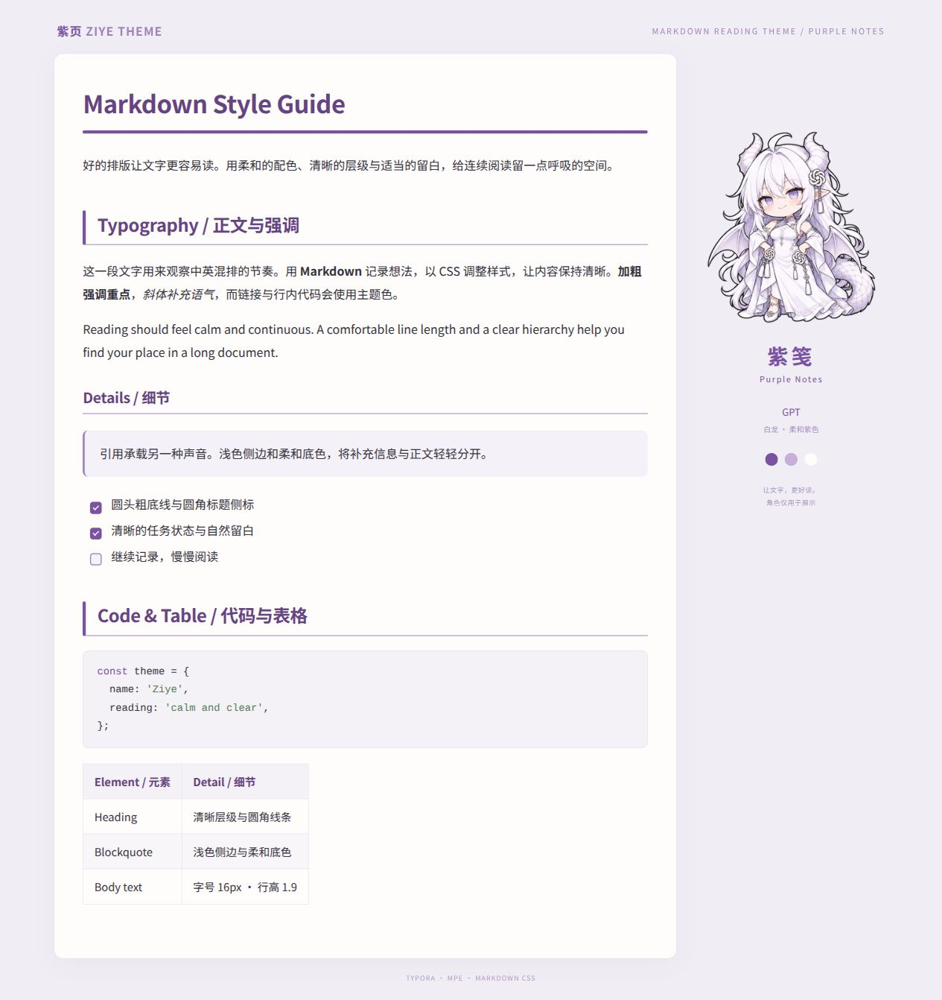
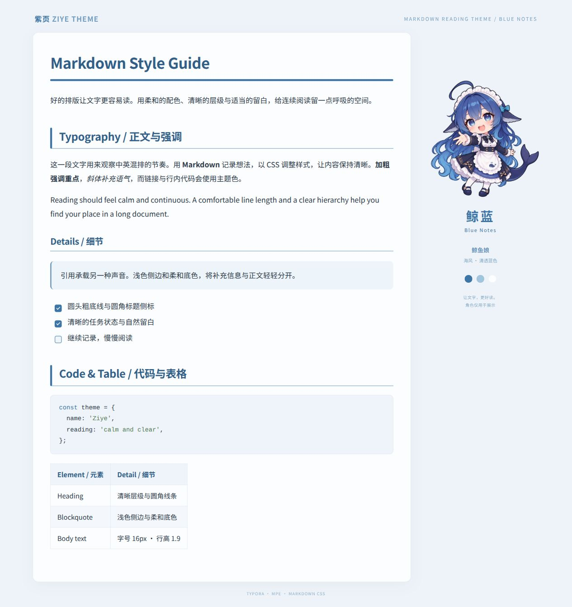

# 紫页 · Ziye Theme

柔和、清晰的 Markdown 阅读主题，适用于 **Typora、VS Code MPE 和 Markdown 网页**。紫笺与鲸蓝两种配色，每种只需一个 CSS 文件。

## 预览

### 紫笺 · Purple Notes

暖白纸面与柔和紫色。下载：[purple-notes.css](purple-notes.css)

### 鲸蓝 · Blue Notes

清浅蓝色与舒展留白。下载：[blue-notes.css](blue-notes.css)

预览为浏览器样张，角色仅用于展示图；安装后只有正文排版。

## 使用

### Typora

1. 下载喜欢的配色对应的 CSS 文件。
2. 打开「偏好设置 → 外观 → 打开主题文件夹」。
3. 将 CSS 放入主题文件夹，重启 Typora。
4. 在主题菜单中选择 **Purple Notes** 或 **Blue Notes**。

### VS Code · Markdown Preview Enhanced

运行 `Markdown Preview Enhanced: Customize CSS`，备份已有样式后，将所选 CSS 的完整内容粘贴进 `style.less`，保存并刷新预览。

### Markdown 网页

引入所选 CSS，为渲染后的正文容器添加 `class="markdown-body"`。每次启用一种配色即可。

## 自定义

直接修改 CSS 开头的颜色变量、字体、`font-size`、`line-height` 和 `max-width`，即可调整配色与阅读密度。公式、图表等扩展语法由所用编辑器解析。

## 致谢与许可

配色与阅读排版参考 [typora-purple-theme](https://github.com/hliu202/typora-purple-theme)，README 展示方式参考 [Konayuki](https://github.com/aerandirsf/Konayuki)。主题 CSS 独立实现，采用 [MIT](LICENSE) 许可。

展示图中的 Q 版角色来自 `whale-girl` 项目的 AI 辅助改编资产，角色插画不适用本仓库的 MIT 许可：

- **GPT（白龙形象）**：原设 [ZipZipPipe，Pixiv 第 4 页](https://www.pixiv.net/artworks/148186519)，按原资产记录保留署名、仅限非商业使用。
- **鲸鱼娘**：角色原设 **上善**，二次设计 [ZipZipPipe，Pixiv 第 1 页](https://www.pixiv.net/artworks/148186519)，沿用原资产记录的 [CC BY-NC-SA 4.0](https://creativecommons.org/licenses/by-nc-sa/4.0/) 许可；上善原始发布页未独立核验。

转载或改编展示图时，请保留以上来源与署名，并遵守相应的非商业及相同方式共享条件。CSS 文件不含图片，也不加载角色资源。
